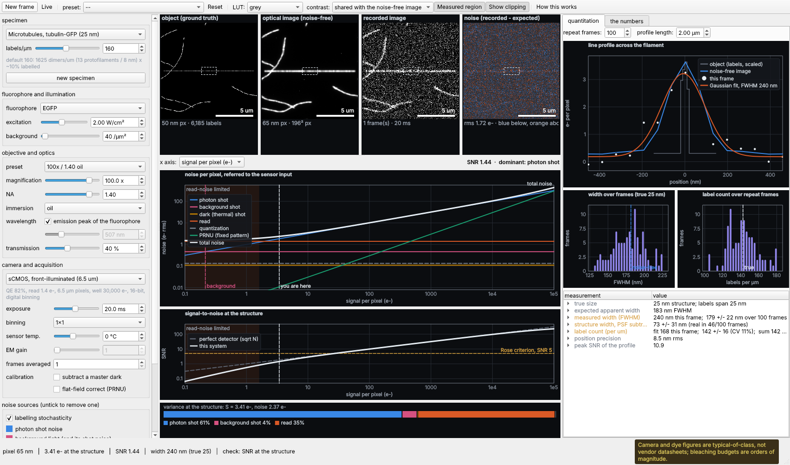
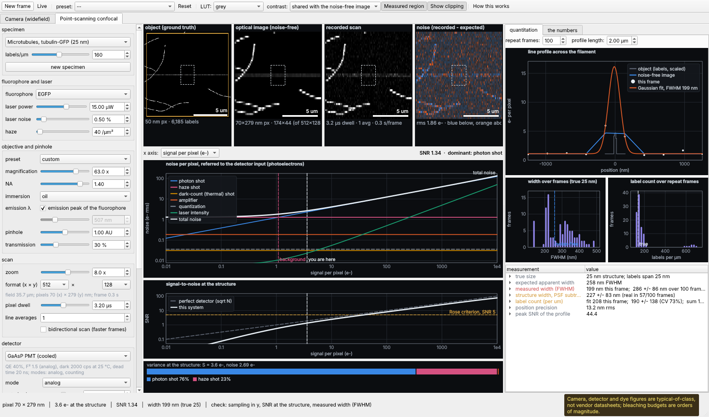

# NoiseWidget

An interactive model of where the noise in a fluorescence micrograph comes from, and
what it does to the numbers you measure. A companion to MicroscopeWidget, built in the
same style as MicroscopeVuilder: a headless numpy model, a PySide6 front end, and every
number shown with its equation and your values in it.

Aimed at graduate students and facility users: turn the levers you have on a real
microscope and watch the image, the noise budget and the measurement respond.



## Two frames

The window has one frame per instrument. Both share the panes, the graph and the
quantitation, so the same microtubule can be compared across them.

* **Camera (widefield)**: every pixel exposed at once onto an sCMOS, EMCCD, CCD or
  CMOS sensor. The levers are exposure, binning, EM gain and sensor temperature.
* **Point-scanning confocal**: a focused spot visits each pixel for a dwell time,
  through a pinhole, onto one detector (multialkali PMT, GaAsP PMT, hybrid, or
  SPAD), in analog or photon-counting mode. The levers are laser power, pinhole (AU),
  dwell, zoom, x and y pixel counts set independently, line averaging, detector gain
  (HV), offset and bit depth.



## What it shows

Four image panes, left to right:

1. **Object**: the specimen as it really is. Fluorophore positions on 25 nm
   microtubules, 7 nm actin, or 100/200 nm beads, at the real label geometry.
2. **Optical image**: blurred by the PSF for your NA and wavelength, then sampled
   with no noise. A camera pixel is an area integral. A scanner averages along each
   line as the beam sweeps, and point-samples between lines. When the scan covers
   less than the specimen, the object pane outlines the scanned area.
3. **Recorded image**: what the camera or detector reports, with every noise source
   applied.
4. **Noise**: recorded minus expected. This is the noise on its own, including the
   fixed pattern that frame averaging cannot remove.

**The live noise graph** plots each noise term in electrons against signal, exposure
or excitation. Read noise is flat, shot noise rises as √S and PRNU rises as S. The
graph shades the read-noise-limited region, marks your operating point, plots SNR
against a perfect detector and the Rose criterion, and has a bar showing where the
variance goes.

**Quantitation** measures the structure at the centre of the field (dashed box). It
takes a line profile, fits a Gaussian, and reports width, label count and position.
It then re-records the same scene up to 2000 times, so the spread that noise causes
appears beside the ground truth. A 25 nm microtubule measures ~180 nm at NA 1.4. That
width is the PSF, and noise is why subtracting the PSF does not recover 25 nm.

## The levers

| Group | Levers |
|---|---|
| Specimen | microtubules (tubulin-GFP or immunostained), actin, beads; label density; new field |
| Light | fluorophore (EGFP, Alexa 488, mCherry, Cy3, Alexa 647), excitation irradiance, background |
| Optics | objective preset, magnification, NA, immersion medium, emission wavelength, transmission |
| Camera | sCMOS (two), EMCCD, CCD, uncooled CMOS; exposure, binning, sensor temperature, EM gain |
| Acquisition | frames averaged, dark-frame subtraction, flat-field correction |
| Noise sources | each can be switched off: labelling, photon shot, background, dark (thermal), EM excess, CIC, read, fixed pattern, quantization, clipping |

On the confocal frame:

| Group | Levers |
|---|---|
| Laser | fluorophore, laser power at the sample (µW, giving kW/cm² at the focus, with saturation), laser intensity noise, out-of-focus haze |
| Optics | objective, NA, immersion, emission wavelength, pinhole (Airy units), transmission |
| Scan | zoom (field = FN / (M × zoom)), pixels per line (x), lines (y), pixel dwell, line averages, bidirectional |
| Detector | PMT / GaAsP / hybrid / SPAD; analog or counting; gain as ADU per photoelectron; offset; bit depth; temperature; dead-time correction |
| Noise sources | each can be switched off: labelling, photon shot, haze, dark counts (thermal), gain excess noise (F²), amplifier, quantization, laser noise, dead time, afterpulsing, clipping (high and black) |

Presets make one point each, often in pairs. For example: a read-noise-limited image,
then the same light rescued by binning, then by an EMCCD.

## Running it

```sh
pip install -e ".[ui]"
python -m noisewidget --ui                         # open the widget
python -m noisewidget                              # print the explained noise budget
python -m noisewidget --preset "Saturated"         # any preset, headless
python -m noisewidget --set na=0.75 --set medium=air --set read=off
python -m noisewidget --frame confocal            # the confocal's report
python -m noisewidget --preset "Offset too low (black clipping)"
python -m noisewidget --list-presets
```

In the widget: `Ctrl+R` records a new frame of the same scene, `Space` streams frames
live, and `F1` explains the layout.

### Embedding in MicroscopeWidget

`NoiseWidget` is a plain `QWidget`, so it can go in a tab or a dock:

```python
from noisewidget.ui.widget import NoiseWidget
from noisewidget.physics.acquisition import Levers

tabs.addTab(NoiseWidget(Levers(na=1.4, magnification=60)), "noise")
```

It emits `simulated(Simulation)` after every recompute and `summaryChanged(str)` for a
status bar. `set_levers(...)` lets a host push its own objective and camera settings in.

## A note on the numbers

Camera and detector presets are **generic classes**, not products. Fluorophore photophysics
are peak literature values, and bleaching budgets are orders of magnitude. All are
recorded from secondary sources and are not datasheet-verified; the widget says so in
its status bar. What the lesson depends on is the ratios: read noise against shot noise,
F² = 2 against read noise divided by gain, NA⁴-ish brightness. Those are
representative. See [`docs/PLAN.md`](docs/PLAN.md) for the model and its limits.

## Development

```sh
python -m venv .venv && . .venv/bin/activate
pip install -e ".[dev,ui]"
pytest -q
```

Everything outside `ui/` is importable and testable headless. The Qt tests run on the
offscreen platform, which CI uses too. The core tests check that the simulated pixel
variance matches the analytic budget the graph draws, for every camera class.

### Building the executable

```sh
pip install "pyinstaller>=6.22"
pyinstaller packaging/noisewidget.spec --noconfirm
./dist/NoiseWidget --list-presets   # smoke-test the frozen build
```

`.github/workflows/release.yml` builds for Linux, Windows and both macOS architectures,
as MicroscopeVuilder's does.
